# Outbreak AR

An augmented-reality zombie survival shooter for Android and iOS, built with **Unity 6.6** (6000.6.6f1), URP 17 and AR Foundation 6.6.

Scan your room, then hold off waves of zombies that claw up out of your floor. Turn to find them, listen for where they are, dodge acid and shoot to survive. Between fights, level up, complete daily missions and spend Supply Points on new guns.

<p align="center">
  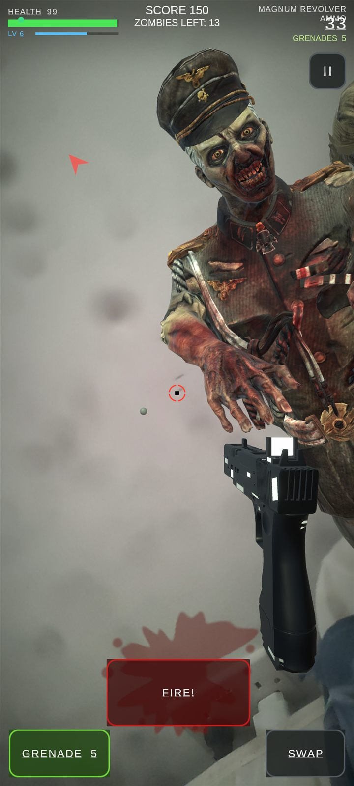
  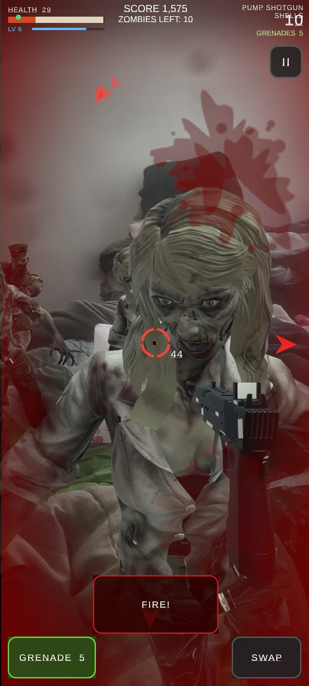
  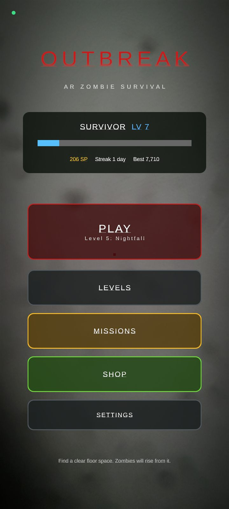
</p>
<p align="center"><em>Running on a Redmi Note 10 Pro (Android 13).</em></p>

## Screenshots

### Realistic zombies and gore
Mixamo characters and animations (walk, run, scream, bite, crawl, hit reactions), blood that sprays, pools on the floor and sticks to wounds, headshot kills that take the head off, and blood on the screen when you're hit.

<p align="center">
  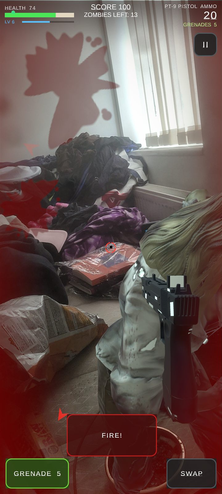
  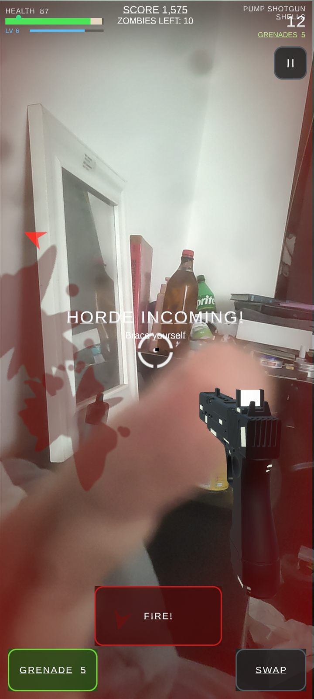
  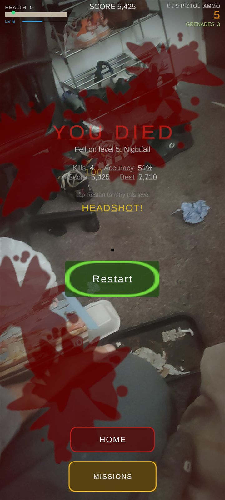
</p>

### Spitters and acid
Spitters hang back and lob acid at where you stand. Step aside to dodge it, or shoot it out of the air.

<p align="center">
  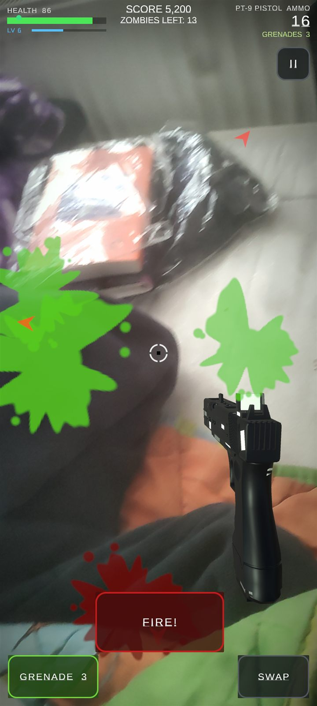
  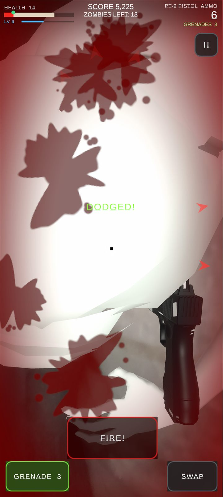
</p>

### Home, missions and progression

<p align="center">
  
  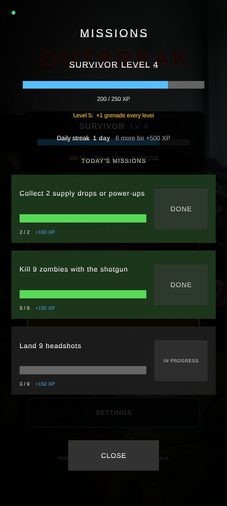
  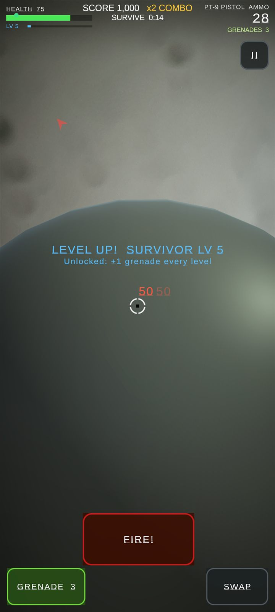
  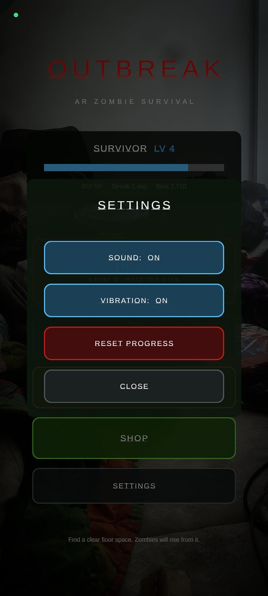
</p>

### Arsenal shop
Spend Supply Points on new guns, upgrades and items.

<p align="center">
  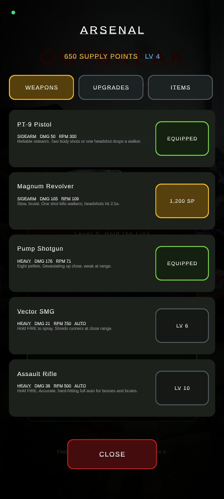
  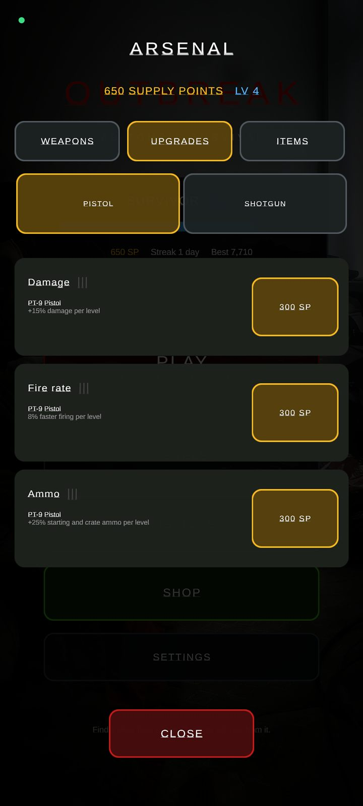
  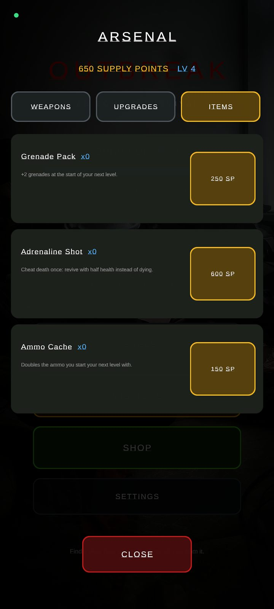
</p>

## Campaign

| Chapter | Level | Objective |
|---|---|---|
| 1: Outbreak | 1. First Contact | Eliminate 6 walkers |
| | 2. They're Fast Now | Eliminate 10; runners and crawlers appear |
| | 3. Hold the Line | Survive 60 seconds; first spitters |
| | 4. The Brute | Boss: the Brute King |
| 2: Nightfall | 5. Nightfall | Eliminate 14, horde rushes |
| | 6. Surrounded | Survive 75 seconds |
| | 7. No Way Out | Eliminate 18 |
| | 8. The Abomination | Final boss |

Chapter 1 runs in `Level1.unity` and Chapter 2 in `Level2.unity`. Levels within a chapter follow on without reloading the scene, so you only scan the room once per chapter. All level data lives in `Assets/Scripts/LevelCatalog.cs`.

## Features

**Modes**
- Campaign: eight levels over two chapters (below).
- Endless: escalating waves with a short break between them; your ten best runs are kept.
- Hunt: zombies hide around your real room. Follow the radar and their breathing; they wake when you get close, look straight at them or shoot.
- World map: real GPS map with outbreak sites, boss nests and supply caches around you (rare caches at real parks), and rewards for walking.

**Catching and the Zombie-dex**
- Wound a zombie and throw a trap; the catch chance rises as it weakens. Rare glowing mutants.
- The Zombie-dex shows a portrait of every kind you've met, with rarity and catch counts.

**Augmented reality**
- Depth occlusion: on phones with ARCore Depth (confirmed on a Redmi Note 10 Pro), zombies are hidden behind real furniture and walls.
- Zombies rise from the floor plane ARCore detects, with a warning first (blood seeps up and a groan comes from the spot). Later levels spawn them out of view so they walk in.
- ARCore light estimation drives the scene lighting, and a shadow-catcher floor receives the zombies' shadows.
- 3D positional sound: groans and footsteps come from the direction of each zombie.

**Enemies**
- Walkers, fast Runners, low Crawlers, acid-spitting Spitters, armoured Brutes and two bosses that summon reinforcements and enrage at half health.
- Zombies curve in from the sides, stagger and react when shot, and roar before their first attack lands.

**Combat**
- Five guns, each with its own model: PT-9 Pistol, Magnum Revolver, Pump Shotgun, Vector SMG (hold to fire) and Assault Rifle (hold to fire). Carry a sidearm and a heavy gun and tap SWAP.
- Grenades, headshots, combos, hit-stop on kills and slow motion on a level's final kill.
- Power-ups: Rapid Fire, Hollow Points, Cryo Pulse and Shockwave. Supply drops: ammo crates and med kits.

**Progression**
- Survivor levels 1-30 from XP; every XP point also earns a Supply Point to spend.
- Three daily missions and a 7-day streak bonus.
- Arsenal shop: guns, three upgrades per gun (damage, fire rate, ammo) and items (Grenade Pack, Adrenaline Shot revive, Ammo Cache).
- Level select and per-level best scores, saved on the device.
- Survivor profile: name, avatar, rank and lifetime stats.
- 23 achievements with Supply Point rewards and an unlock banner.

**Presentation**
- Home screen with rendered key art, pause menu (also on the Android back button), settings for sound, vibration and graphics quality (Low saves battery; High adds bloom and grain at 60 FPS).
- A tutorial coach for the first fight, replayable from Settings.
- Icons throughout the UI; shop pictures and Zombie-dex portraits are rendered from the game's own 3D models.
- Post-processing: bloom, horror colour grade, film grain and a vignette that pulses when you're hurt.
- Sound effects and particles are generated in code.

## Getting started

1. Open the project in Unity **6000.6.6f1** with Android Build Support.
2. Open `Assets/Scenes/Level1.unity`.
3. Build for Android (ARCore) or iOS (ARKit), or test in the Editor with XR Simulation.

Large binary assets are stored with Git LFS. Run `git lfs install` before cloning.

Keep the project outside OneDrive, Dropbox and other synced folders. Syncing corrupts Unity's `Library` cache and produces broken builds.

### Android build

The build targets API 34 (Android 14) with a minimum of API 30. Build from the editor with **Build > Android APK**, or from the command line with Unity Hub open and signed in:

```
Unity.exe -batchmode -quit -projectPath . -buildTarget Android -executeMethod BuildAndroid.Build
```

On machines with 8 GB of RAM, set `BEE_BUILD_THREADS=3` first, or the native compile can run out of memory. The build script also sets up the zombie materials, the Mixamo characters' textures and the zombie animator before building. The APK is written to `Builds/Android/OutbreakAR.apk`.

## Scripts

| Script | Role |
|---|---|
| `GameControllerScript` | Entry point in each scene: holds the inspector settings, adds the parts below and ticks them in order |
| `Game/LevelFlowManager` | Game state, levels, objectives, Endless waves, win, lose and retry, score |
| `Game/SpawnManager` | Spawning with warnings, hordes, bosses, hunt placement |
| `Game/WeaponSystem`, `Game/WeaponModels` | Ammo, firing, hit detection, grenades, aim, held gun models |
| `Game/PlayerHealth`, `Game/PickupManager`, `Game/CaptureSystem`, `Game/HuntSystem` | Health, pickups and power-ups, traps, hunt radar |
| `Game/UIController`, `Game/ProgressionManager`, `Game/SceneFlow`, `Game/TutorialCoach` | HUD and menus, XP and missions, scene loads, tutorial |
| `ZombieController` | Zombie types, movement, flanking, attacks, gore, boss behaviour |
| `ZombieDex`, `CaptureTrap`, `DexMenu` | Catching and the Zombie-dex |
| `MapScreen`, `MapSites`, `GameModes` | World map, sites and caches, Endless and Hunt setup |
| `ProfileMenu`, `LifetimeStats`, `Achievements`, `AchievementsMenu` | Profile, stats and achievements |
| `AcidGlob`, `Grenade` | Spitter acid and thrown grenades |
| `Arsenal`, `Inventory` | Guns, upgrades and items (saved on the device) |
| `LevelCatalog` | Level definitions and saved progress (`GameProgress`) |
| `MissionSystem`, `PlayerProfile` | Daily missions, XP, survivor level, Supply Points and streak |
| `HomeScreen`, `ShopMenu`, `MissionBoard`, `PauseMenu`, `LevelSelectMenu` | Runtime menus |
| `GameHUD` | Health and ammo panels, crosshair, threat arrows, damage numbers, screen blood, boss bar, banners, results card |
| `ARWorld`, `ARLighting` | Real floor, depth occlusion, light estimation and floor shadows |
| `PostFX`, `GameFX`, `GameAudio`, `UIStyle` | Post-processing, particles, generated sound and UI style |
| `Editor/BuildAndroid` | Command-line and menu Android build |
| `Editor/MixamoImporter`, `Editor/MixamoCharacterSetup`, `Editor/ZombieAnimatorBuilder` | Mixamo import rules, character textures and the zombie animator |
| `Editor/WeaponArt`, `Editor/ZombieArt` | Gun materials, shop pictures, Dex portraits and home key art, rendered from the 3D models |

## Credits

- Zombie characters and animations: Adobe Mixamo.
- Revolver, shotgun, SMG and rifle models: [Ultimate Gun Pack](https://quaternius.com) by Quaternius (CC0).
- Icons: [game-icons.net](https://game-icons.net) by Lorc, Delapouite, Skoll, sbed, Guard13007 and Zeromancer, licensed [CC BY 3.0](https://creativecommons.org/licenses/by/3.0/). Per-icon credits are in `Assets/Resources/Icons/CREDITS.txt`.
- Map tiles: © Esri, HERE, Garmin; map data © OpenStreetMap contributors.
- The original zombie pack, the PT-9M pistol, the music and the gunshot sound are third-party assets owned by their respective creators.
